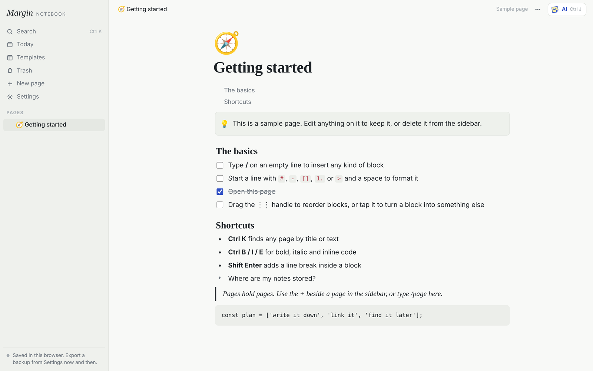

# Margin

**A single-file, local-first Notion alternative with a built-in AI assistant.** Pages inside pages, block editing, templates, a daily page, page history, charts, and an AI that can summarize, draft and rewrite your notes, using Claude, ChatGPT, Gemini or a local Ollama model.

**[Try it live in your browser →](https://arukalahimateja.github.io/Margin/)** No install, no account, no server.



- **One file.** The whole app is `margin-notebook.html`. Download it, double-click it, done.
- **Local-first.** Notes stay in your browser. There is no Margin server and no telemetry.
- **Bring your own AI.** Gemini (free tier), OpenAI, Anthropic, or Ollama running on your own machine.
- **Lives inside Claude, too.** Publish it as a Claude artifact and your notes sync through your Claude account, with the AI running on your Claude plan.

### Not yet

Margin is an early version. If you're coming from Notion, these are missing today:

- **Tables and databases.** No table block, no database rows-as-pages, views, filters or relations. This is the top item on the roadmap.
- **Sync and sharing outside Claude.** In the browser version, notes live in one browser on one device. No sharing, no real-time collaboration, no comments.
- **Import from Notion.** You can export to Markdown and back up to JSON, but not import a Notion export.
- **Layout and styling.** No multi-column layouts, page covers, text colors or highlights.
- **Embeds.** No YouTube, tweet, map or web-bookmark blocks. Images, files and charts work.
- **Math and diagrams.** No equations or Mermaid diagrams.
- **Dates and mentions.** No `@` mentions of dates or people, and no reminders.
- **Editing many blocks at once.** You can't select several blocks to move or delete them together.

If one of these is a dealbreaker for you, say so in [Issues](https://github.com/ArukalaHimateja/Margin/issues). That's how I decide what comes next.

---

## Two ways to run it

### Path A: inside Claude (claude.ai)

Your notes are saved to your Claude account and sync across your devices. The AI runs on your Claude plan with no API key.

1. Open a new chat at claude.ai.
2. Attach `margin-notebook.html`.
3. Paste this message exactly:

   > Publish this file as an artifact with the db, user, sample, downloads and assets capabilities.

4. Open the artifact Claude creates. Pin or bookmark it.
5. The first time you use an AI feature, Claude asks permission. Allow it.

To check it worked, the bottom-left of the sidebar should say **"Saved to your account."** If it says "Saved in this browser only," the capabilities weren't turned on; repeat step 3 in the same chat.

### Path B: in any browser

Use the **[live link](https://arukalahimateja.github.io/Margin/)**, or download `margin-notebook.html` and double-click it. Notes are saved in that browser.

To turn on the AI, open **Settings** in the sidebar, choose a provider, paste a key, then press **Test**.

| Provider | Cost | Where to get a key |
|---|---|---|
| **Gemini** | Free tier | aistudio.google.com → *Get API key* |
| **OpenAI** | Pay per use | platform.openai.com → *API keys* |
| **Anthropic (Claude)** | Pay per use | console.anthropic.com → *API keys* |
| **Ollama** | Free, runs on your computer | ollama.com, then see [Using Ollama](#using-ollama) below |
| **Any OpenAI-compatible API** | Varies | OpenRouter, LM Studio, vLLM and others: paste the base URL ending in `/v1` |

A ChatGPT Plus or Claude Pro subscription does **not** include an API key. API keys are a separate account with separate billing. To just try the AI, use Gemini.

---

## Using Ollama

Ollama refuses requests from web pages it doesn't recognize, so you have to tell it which page may connect. Set `OLLAMA_ORIGINS`, then **fully quit and restart Ollama**.

**For the live link**, allow only that site:

- **Windows** (PowerShell), then quit Ollama from the system tray and start it again:
  ```powershell
  setx OLLAMA_ORIGINS "https://arukalahimateja.github.io"
  ```
- **macOS** (Ollama app), then quit and reopen the app:
  ```bash
  launchctl setenv OLLAMA_ORIGINS "https://arukalahimateja.github.io"
  ```
- **Linux** (systemd): run `sudo systemctl edit ollama.service`, add the lines below, then `sudo systemctl restart ollama`:
  ```ini
  [Service]
  Environment="OLLAMA_ORIGINS=https://arukalahimateja.github.io"
  ```
- **Running `ollama serve` by hand:**
  ```bash
  OLLAMA_ORIGINS="https://arukalahimateja.github.io" ollama serve
  ```

**For the downloaded file** (opened as `file://`), the browser sends no usable origin, so use `OLLAMA_ORIGINS=*` in the commands above. Be aware that `*` lets *any* website you visit talk to your local Ollama while it's running; switch it back when you're done if that matters to you.

Then pull a model (for example `ollama pull llama3.2`), open **Settings → Ollama**, type the model name and press **Test**.

**Allow the browser prompt.** Chrome, Edge, Brave and Opera ask before a website may talk to apps on your computer. When you press **Test**, choose **Allow**. If you dismissed or blocked it, click the icon to the left of the address bar, set **Apps on device** (older versions: **Local network access**) to **Allow**, and reload. Setting `OLLAMA_ORIGINS` alone is not enough; both are needed.

**Pick a model big enough for the job.** Answer mode (summarize, draft, rewrite) works with small models like `llama3.2`. **Make changes**, which plans edits across pages, needs a 7B+ model such as `qwen2.5:7b`; smaller models tend to propose one rewrite instead of the steps you asked for. Either way, review each step and its preview before you press **Apply**. Nothing changes until you do, and one click undoes it.

Safari may block the live site from reaching `localhost` entirely. If Test fails in Safari, use another browser or the downloaded file.

---

## Privacy and your API keys

- Your notes and your API key are stored in your browser's local storage. Nothing is sent to any Margin server, because there isn't one.
- When you use an AI feature, the text you send goes **directly from your browser to the provider you chose** (Google, OpenAI, Anthropic, an OpenAI-compatible server you set, or your own Ollama), and to no one else.
- The only other network requests: the page loads its fonts from Google Fonts, and **Export page as PDF** loads the jsPDF library from cdnjs the first time you use it. Neither receives your notes.
- Don't take this on trust: it's one HTML file. Search it for `fetch(` and `https://` to see every network call it makes.
- Anyone who can use your browser profile can read the stored key. On a shared computer, use a key with a spending limit, or Ollama.

## Back up your notes (Path B)

Browser-only notes are deleted if you clear your browsing data, and they don't appear on your other devices.

- **Settings → Export notes** about once a week. Backups hold your text, not images or attached files.
- **Settings → Import backup** restores your notes, or moves them to a new device.

---

## Quick tips

- Type **/** on an empty line to add any kind of block, including **/ai** to have the AI write for you.
- Start a line with `#`, `-`, `[]`, `1.`, or `>` followed by a space to format it instantly.
- Select text to make it bold or italic, or ask the AI to improve or shorten it.
- **Ctrl/⌘ K** searches all your pages. **Ctrl/⌘ J** opens the AI panel.
- Drag the **⋮⋮** handle to move a block, or tap it for more options.
- **Today** in the sidebar opens a page for the day, with yesterday's unfinished to-dos carried over.
- **Templates** start a meeting, idea, project or reading page. Any page can become a template from its **⋯** menu.
- In the AI panel, switch to **Make changes** and describe what you want, like "turn this into a task list". The AI proposes changes, nothing happens until you tick and apply them, and one click undoes the whole set.
- Paste or drag an image or file into a page, or type **/image** or **/file**.
- Ask the AI for a graph ("plot sin(x) and cos(x)", "bar chart of these numbers") and Margin draws a real chart. Type **/chart** to make one yourself.
- **⋯ → Export page as PDF** makes a PDF of the page. It covers English and Western European text; emoji and other scripts are left out. Outside Claude, **⋯ → Print** gives a full copy.
- Select text and press **Link** to link it to a website, or paste a URL to link it straight away. Click a link to open it.
- Type `[[` to link to another page. Deleted pages go to **Trash** for 30 days, and **⋯ → Page history** restores older versions.

## Optional: add to Margin from your terminal (Claude Code)

Only for Path A copies (published inside Claude). The browser-only copy can't be reached from a terminal.

1. Copy [`skills/margin-add/SKILL.md`](skills/margin-add/SKILL.md) from this repo.
2. Replace `PASTE-YOUR-MARGIN-ARTIFACT-LINK-HERE` with your own Margin link. Open your Margin in Claude, then use **Share → Copy link**.
3. Save it as `~/.claude/skills/margin-add/SKILL.md`, start a new Claude Code session, and run `/login` with your claude.ai account. It doesn't work with an API key.
4. Use it like this:

   ```
   /margin-add "Reading list" Designing Data-Intensive Applications, chapter 3
   /margin-add "Project notes" ./diagram.png
   ```

It finds the page by title, adds your text, files or images as proper blocks, and leaves the rest of the page alone. It works in interactive Claude Code sessions only, not in `claude -p` scripts. If the page is open in Margin while it writes, click outside the text or reload to see the change.

## Troubleshooting

- **"The provider rejected the API key"**: the key was pasted incorrectly or has expired. Make a new one.
- **"Doesn't recognize that model name"**: open Settings and type a current model name from the provider's website.
- **"Couldn't reach Ollama"**: allow the browser's "apps on device" prompt (or re-enable it from the icon left of the address bar), and make sure Ollama is running and was restarted after setting `OLLAMA_ORIGINS`. See [Using Ollama](#using-ollama). In Safari, try another browser.
- **My notes disappeared**: you're probably in a different browser, a private window, or on a different device. Open the original, or import your last backup.

## Contributing

This is an early version. Bug reports and ideas are welcome in [Issues](https://github.com/ArukalaHimateja/Margin/issues).

## License

[MIT](LICENSE)
